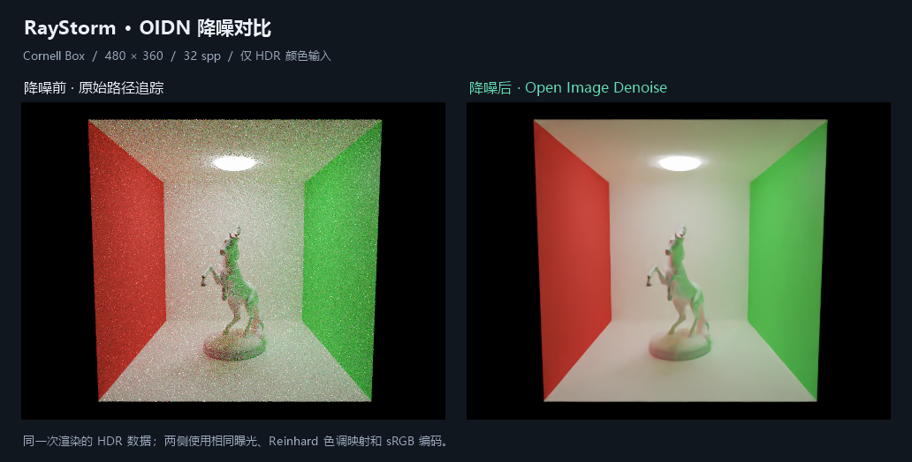

# 修复验证记录

## 2026-11-15 OIDN 颜色图降噪

通过 Unity 内置 `com.unity.rendering.denoising` 1.0.2 接入 OIDN；本机 Windows 原生库版本为 1.4.2，使用 CPU 同步接口，仅输入线性 HDR 颜色图。整帧后处理完成后执行降噪，结果单独保存；显示、自动导出及手动保存读取同一最终结果。原始累积及样本数不变，新帧和尺寸变化清理旧结果，失败时回退原图。

Unity 2022.3.62f3c1、Intel Iris Xe、D3D11，在隔离副本中完成以下检查。正式工程与副本的 130 个 RayStorm 文件逐一校验一致；没有修改或保存用户打开的场景。

- 现有 `RayStormValidation.RunAll` 在 Gamma 模式通过。原有渲染器测试明确关闭降噪，保留采样、累积及显示的原始断言。
- 新增 `RayStormDenoisingValidation.Run` 在 Gamma、Linear 均通过：源 HDR 逐像素不变、样本数 alpha 保留、输出有限且保留大于 1 的亮度、启用/禁用后的输出选择、新帧结果失效和纹理释放。
- 已知均匀 HDR 信号的合成噪声用例，红通道 MSE 从 0.120758 降至 0.006354。常量输入 `(2,4,8)` 的降噪均值约为 `(2.00,4.00,7.99)`，通过各通道 2% 容差。这是数据链路检查，不是示例场景画质评分。
- CornellBox 在 Gamma 下以 480×360、每像素 32 个样本、随机初始化种子 137 完成渲染。原图与降噪图来自同一累积缓冲；逐像素样本数全部为 32，原图与样本数保留检查通过，降噪结果均有限。渲染和后处理共 18.73 秒，包含测试原图快照，不含文件导出；不作为 OIDN 单独耗时。
- 输出 PNG 使用相同的曝光 1、Reinhard 映射及 sRGB 编码，同时保留线性浮点 EXR。测试每次最多提交 1024 条路径并同步 GPU，未改变正式运行时的调度配置。

原始 PNG、EXR、参数及日志保留于 `D:\Codex\2026-11-15\raystorm-denoising\outputs`（两张原始文件在 `gamma` 子目录）。本次未验证 Player 构建或其他图形 API。只有颜色输入时，雕像细小轮廓可见一定柔化；当前同步实现包含 GPU 读回和上传，会在帧尾阻塞主线程。

## 2026-11-15 SAH BVH

正式场景加速结构切换为 12 桶 SAH 二叉 BVH，目标叶容量 8，最大深度 31。每个三角形保留一份原始几何 ID 引用，材质和发光面映射沿用该 ID。最近命中按近到远遍历，精确等距时取较小的几何 ID。阴影查询保留严格的光线终点。静态场景继续复用 GPU 缓冲，旧场景的八叉树显示开关自动迁移到 BVH 叶节点显示。

Unity 2022.3.62f3c1、Intel Iris Xe、D3D11。Gamma 和 Linear 均通过 `RayStormValidation.RunAll`，覆盖结构完整性、空场景、远坐标薄面、GPU 共面等距命中、光源能量、有限阴影、缓存复用和资源释放。正式工程与验证副本的 126 个 RayStorm 文件逐一校验一致。

使用当前场景配置，通过正式追踪和累积入口以 Gamma、64×36、种子 172337、最高 816 spp 完成 Spheres、Desktop 和 MultiObjects。各场景实际样本数为 304～816，无 NaN、Inf 或负值像素。独立验证程序每批限制为 1024 条路径，等 GPU 完成后再提交下一批。最大批次墙钟为 46.90 ms，测试期间未记录 GPU 超时重置。运行时仍使用现有的任务调度参数。

Desktop 与 MultiObjects 在上轮隔离试验后修改了共用白色材质的光滑度。用上轮材质在隔离副本复跑，三个场景的逐像素样本数均与上轮一致。与同输入的旧八叉树输出对照如下。

| 场景 | 最大线性 RGB 差 | 8 位 PNG 差异像素 | 最大色阶差 |
| --- | ---: | ---: | ---: |
| Spheres | 0.000119 | 0 | 0 |
| Desktop | 0.019365 | 5 | 1 |
| MultiObjects | 0.017457 | 9 | 1 |

正式实现与上轮 BVH8 原型仍存在少量浮点路径差异。正式版本的验证结论以上表的同输入对照为准。

## 2026-11-14 NEE＋MIS 与场景光源接入

正式追踪入口接入 NEE＋MIS，自动采集 Unity Directional、Point、Spot Light、材质发光三角形及 HDR Cubemap。光源参数和环境变化重启当前累积，静态场景复用光源采样表，几何不变时继续复用八叉树和几何缓冲。三个现有场景补齐环境采样 Compute Shader 的序列化引用。

删除旧 `RayHit*Surface`、`RayHitSkybox` 着色分支和未使用的 `RSSceneLight` 空脚本；试验开关、独立基准场景及 Player 测试脚本保留在工程外。新增调用保持单行，没有新增运行时断言。

Unity 2022.3.62f3c1、Intel Iris Xe、Direct3D 11。正式工程与隔离验证副本的 120 个 RayStorm 文件逐一校验一致。

- Gamma、Linear 均通过 `RayStormValidation.RunAll`，保留此前相机、建树、累积、显示和资源清理回归。
- 新增 18 项光源能量测试，每项 65536 条光线，覆盖三类解析灯、距离衰减、聚光锥过渡、有限阴影终点、发光面细分、Gamma/Linear HDR、漫反射与镜面混合、玻璃折射率和折射率匹配情形。所有 RGB 均有限且非负，均值落在解析参考的 `0.002 + 5 × 标准误差` 容差内。
- 渲染器回归覆盖灯光强度、朝向、类型、启停和图层变化，原地更新 Cubemap、材质发光变化，以及采样表复用、重建和释放；光源变化不重建几何缓冲。
- Windows x64 Development Player 构建成功，并实际运行六类场景。使用正式渲染器、Unity Light、Standard 发光材质和运行时线性 HDR Cubemap，每帧 `32×32`、`64 spp`；六帧均完成，无无效像素，样本数全部正确。

Player 能量检查（Gamma 项目，读取线性累积结果）：

| 场景 | 实测均值 | 解析参考 | 结果 |
| --- | --- | --- | --- |
| 平行光 | 0.763944 | 0.763944 | 通过 |
| 点光 | 0.763467 | 0.763944 | 通过 |
| 聚光灯 | 0.763467 | 0.763944 | 通过 |
| 自发光面 | 3.542893 | 3.546409 | 通过 |
| HDR 环境 | 3.201084 | 3.200000 | 通过 |
| 混合照明 | 6.530842 | 6.501092 | 通过 |

Player 容差为 `0.02 + 5 × 标准误差`，包含有限相机视野与蒙特卡洛采样误差；没有把混合场景的单次均值当作精确解。

两个当前示例场景以 Gamma、`192×108`、最高 `816 spp` 完成渲染并检查 EXR/PNG，自适应收敛的像素提前停止：

| 场景 | 实际每像素样本数 | NaN/Inf 或负值像素 | 最大线性 RGB 分量 |
| --- | --- | --- | --- |
| Desktop | 304～816 | 0 | 69.866821 |
| MultiObjects | 304～816 | 0 | 40.320862 |

现有 Unity 灯光现在参与照明，成图不要求与此前忽略解析灯的版本逐像素一致。本轮验证接入与正确性，没有重新测量等耗时噪声收益。D3D11 编译仍报告寄存器压力和 `SampleBSDF` 潜在未初始化警告；源码检查中相关局部量均有赋值，上述 GPU 回归未复现无效输出。其他图形 API、Linear Player 和移动端未验证。

## 2026-11-14 图块角标与采样进度

青色整块填充改为白色短角标与黑色细边，底部增加两像素采样进度条及一像素分隔线。两项提示可分别在 Inspector 关闭，完成时自动隐藏。复用原显示 pass，未增加纹理、缓冲或 GPU 读回；旧 `BlockColor` 参数、绑定与填充代码已删除。

进度按验证、裁剪后任务的 `宽 × 高 × spp` 累计，使用 `long` 计数，每次显示刷新传入采样计数快照，与对应图像一并呈现。它表示当前显示结果的采样进度，不包含场景准备和导出耗时。

Unity 2022.3.62f3c1、Intel Iris Xe、Direct3D 11 的隔离 Gamma、Linear 副本均通过 `RayStormValidation.RunAll`。

- GPU 读回确认角标短臂、黑边、内部和边中留白、图像边界，以及 `1×1`、`2×2` 输出；黑白提示在 Gamma、Linear 下保持一致。
- 验证进度为 0、50%、100% 时的填充边界、关闭后的恢复、源 RGBA 与导出数据不受污染。
- 渲染器集成覆盖任务加权与裁剪、两个显示开关、共享 Shader 的多实例、空任务、完成清除、环境/尺寸变化后的重启，以及超过 32 位整数的总采样量。

先用此前固定输入的两个示例场景，以 Gamma、`192×108`、`816 spp`、种子 `172337` 完整渲染。约 50% 时切换提示不改变累积数据；导出 PNG 与修改前的深度 6 成图文件逐字节一致。最终显示浮点值与对照色调映射的最大误差为 `1.79e-7`；显示与导出比较：Desktop 仅 1 个像素相差一个 8 位色阶，MultiObjects 完全一致。

随后同步主工程现有相机与材质配置，核对 112 个相关资产文件一致，再次渲染两个场景。启用与关闭提示分别完成整帧，累积 RGBA 逐像素完全一致；所有像素样本数均为 816，无 NaN/Inf、负值，完成后提示均消失。

本轮仅修改渲染器、显示 Shader、Inspector、相应验证及文档；追踪、累加、八叉树和场景资产未改。未重新构建 Player 或验证其他图形 API。

## 2026-11-14 AABB 快速排除与最大深度 6

正式建树预计算三角 AABB，以原 SAT 的逐轴浮点容差快速排除，再执行原相交测试。渲染器最大深度由 7 改为 6，根节点深度为 0；通用建树接口仍保留深度参数。

Unity 2022.3.62f3c1、Intel Iris Xe、Direct3D 11。隔离副本的 Gamma、Linear 均通过 `RayStormValidation.RunAll`，永久场景回归同时覆盖深度 6、7 的分割面、远坐标、512 条最近命中射线和空场景。

两个当前示例场景使用 Gamma、`192×108`、`816 spp`、随机种子 `172337`。旧深度 7 与正式版本预热后交错测试，各执行三轮，以下取各路径中位数。

| 场景 | 旧建树 | 新建树 | 旧追踪 | 新追踪 |
| --- | --- | --- | --- | --- |
| Desktop | 10898.57 ms | 3400.51 ms（减少 68.8%） | 3222.57 ms | 3986.65 ms（增加 23.7%） |
| MultiObjects | 3858.36 ms | 1267.01 ms（减少 67.2%） | 886.41 ms | 837.60 ms（减少 5.5%） |

建树包含 AABB 缓存创建与树展开，不含场景采集和 GPU 上传。追踪包含正式 Trace、Additive、CPU 提交与同步等待，不是纯 GPU 时间，不含显示和导出。逐次建树与追踪之和的中位数：Desktop `14121.14 → 7391.35 ms`，MultiObjects `4744.78 → 2104.61 ms`。

深度 6 减少了树节点及几何引用，但 Desktop 的追踪成本增加。建树收益用于首次构建及几何变化后的重建；静态复用帧没有这部分收益。

- 正式版本与旧深度 6、临时 AABB + 深度 6 的节点和引用逐字节一致；渲染器实际生成的树与正式版本一致。
- 两个场景各 8192 条 GPU 射线与旧深度 7 最近命中一致；新旧实现分别通过 420 条合成射线与暴力遍历对照。
- 所有渲染的线性 RGB 和显示值与旧实现完全一致，无 NaN/Inf、负值或样本数错误，每像素均为 816 samples。
- Desktop 节点数 `34287 → 8559`，几何引用 `214888 → 126317`；MultiObjects 节点数 `87331 → 28817`，几何引用 `172376 → 77336`。

临时组合测试保留在工程外；正式代码新增调用保持单行，未增加运行时断言。验证范围为上述编辑器/D3D11 路径，未重新构建 Player 或验证其他图形 API。

## 2026-11-14 GPU 主光线与静态场景复用

Unity 2022.3.62f3c1、Intel Iris Xe、Direct3D 11。隔离副本的 Gamma 与 Linear 均通过 `RayStormValidation.RunAll`。

- GPU 主光线与 Unity 透视、正交相机对照；分块尺寸、顺序及多轮拆分保持采样一致，后续样本不重复首轮。
- 静态帧、相机和环境变化复用八叉树及几何缓冲；材质变化只更新材质。原地修改顶点或索引、变换、启停、图层、增删和蒙皮姿态均正确更新。
- 原有 Gamma/HDR、32768 条粗糙反射光线、尾块、816 spp 排程、预览、多实例及资源释放验证通过。

当前两个示例场景以 Gamma、`192×108`、`816 spp` 完成渲染；均无 NaN/Inf、负值或纯黑像素，所有像素样本数为 816，显示与导出最多相差一个 8 位色阶。

示例批测每次 Update 后同步读回，避免在单帧内连续提交整个任务队列；首次未同步批测发生 D3D11 设备丢失，调整临时脚本后重跑通过。此测试不作为纯 GPU 耗时比较。

正式 `ReloadFrameScene` 实测如下，静态重载取 9 次中位数；首次构建仅测一次，表中不是整帧渲染耗时。

| 场景 | 首次构建 | 静态重载中位数 |
| --- | --- | --- |
| Desktop | 13239.54 ms | 34.22 ms |
| MultiObjects | 4507.53 ms | 5.25 ms |

静态复用仍执行场景采集、顶点转换和精确内容比较，首次构建及几何变化仍需重建八叉树。验证范围为上述编辑器/D3D11 路径，未重新构建 Player 或验证其他图形 API。

## 2026-11-14 Gamma 与 HDR 输入修复

环境为 Unity 2022.3.62f3c1、Intel Iris Xe、Direct3D 11、内置渲染管线。隔离副本的 Gamma 与 Linear 模式均通过 `RayStormValidation.RunAll`。

覆盖 EXR `(0.18, 1, 4)` 导入、线性 Cubemap、多实例、环境切换、材质颜色及 HDR 发光。真实相机输出与导出误差不超过一个 8 位色阶。32768 条粗糙金属反射光线的黑点回归通过。

Gamma 场景验证使用原材质、环境和任务排程，分辨率 `192×108`，随机种子 `172337`。

| 场景 | 每像素样本数 | NaN/Inf 像素 | 纯黑像素 | 最大线性 RGB 分量 |
| --- | --- | --- | --- | --- |
| Desktop | 全部 816 | 0 | 0 | 117.740 |
| MultiObjects | 全部 816 | 0 | 0 | 40.280 |

两幅成图均无负值像素，显示与导出最多相差一个 8 位色阶。

Gamma 导入纹理仍在编码空间过滤，采样后解码不等同于线性过滤。

此次验证覆盖上述 Unity/D3D11 编辑器路径，未重新构建 Player，也未验证 Vulkan、Metal 或移动端。

## 2026-11-10 历史验证

当时的目标工程版本为 Unity 2022.3.27f1，内置渲染管线。

当时本机的 2022.3 安装不完整，集成验证使用隔离副本和 Unity 6000.6.0f1，未升级原工程。以下为该次记录。

## 验证项目

- 八叉树：分割面三角形、远坐标、轴平行边界、512 条射线与暴力遍历最近命中对照。
- 场景：支持的 Renderer、缺少法线/切线/材质、临时网格所有权与相机 Layer。
- 调度：奇数尺寸、尾块裁剪、完整像素覆盖、五轮 816 samples/pixel 和帧数限制。
- GPU：浮点 HDR/计数、不同 spp 加权、越界保护、进度叠加清除、环境和自发光、双面漫反射。
- 渲染器：透视/正交射线、多实例环境隔离、尺寸变化重启、子网格顶点复用与清理。
- Player：Windows Development Build、完成一帧、检查输出像素、写入 persistentDataPath。

## 结果

2026-11-10 实际执行结果：

| 检查 | 环境 | 结果 |
| --- | --- | --- |
| 三个 Compute Shader 独立编译 | DXC，Shader Model 6.0 | 通过 |
| 全部 C# 与 Editor 脚本编译 | Unity 6000.6.0f1 | 通过 |
| SceneValidation | Unity 实际 Vector3/Mathf 与原生场景对象 | 通过 |
| RayStormRuntimeValidation | Unity Editor | 通过 |
| RayStormGpuValidation | NVIDIA GeForce RTX 5080 / Direct3D 11 | 通过 |
| RayStormRendererValidation | 同上，真实 GPU 读回和原生资源清理 | 通过 |
| Windows Development Player 构建 | 隔离测试场景，显式 Shader 引用 | 通过 |
| Player 冒烟测试 | 128×96，一帧完成，有限像素值、采样数和 JPEG 文件检查 | 通过 |

统一验证返回 `passed: true`；Player 记录 `RAYSTORM_PLAYER_SMOKE_PASSED`，输出到其独立的 persistentDataPath。未改动原工程的 Unity 版本或使用 Unity 6 回写原工程资产。

Unity 6 对为兼容 2022.3 保留的 `FindObjectsOfType` 给出弃用警告；构建编辑器退出时出现 Unity 内部 JobTempAlloc 提示，未据此宣称整个 Unity 进程没有内存问题。回归验证已确认本渲染器持有的 RT、Cubemap 和 ComputeBuffer 正确释放。

## 尚未覆盖的环境

Unity 2022.3 原版本编辑器、Metal/Vulkan/移动端、长时间运行及大规模场景性能仍需在对应环境验收。本次没有把独立 DXC 编译或 Unity 6 验证等同于这些环境已通过。
