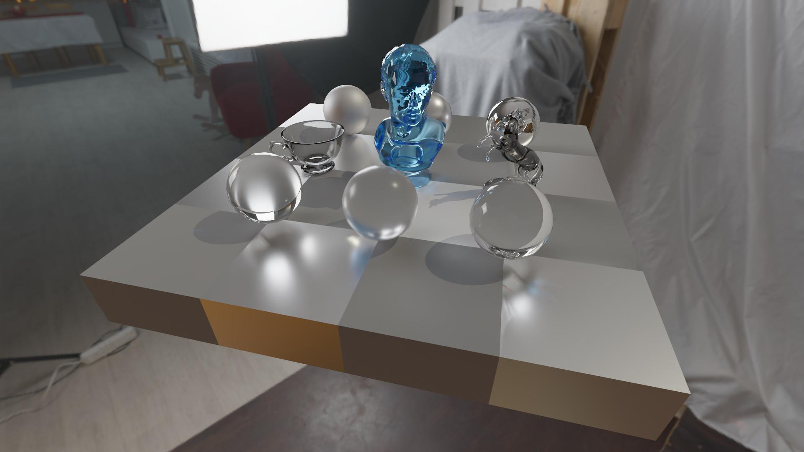
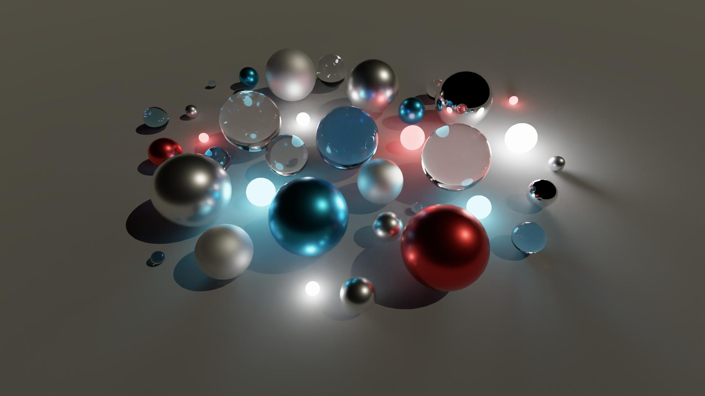
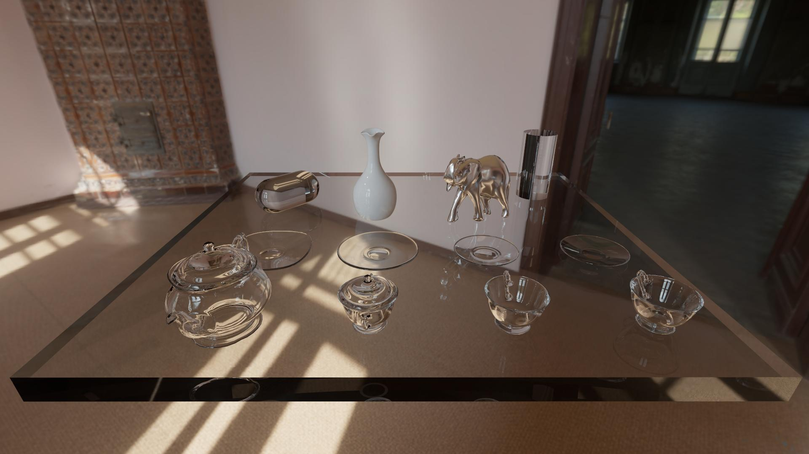
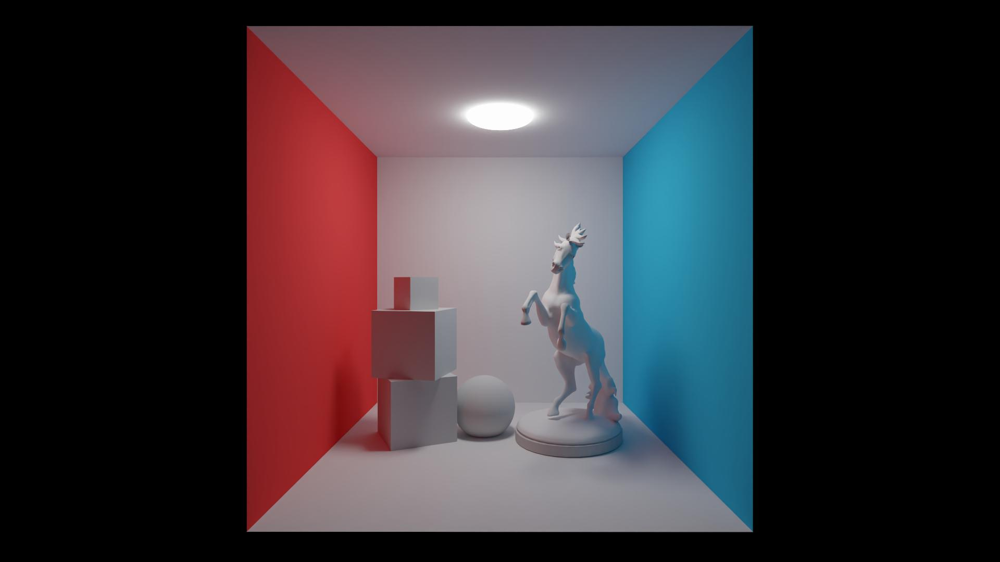

# RayStorm

RayStorm 是基于 Unity Compute Shader 的 GPU 路径追踪器，支持漫反射、金属和玻璃材质。它使用 SAH BVH 加速求交，对 Unity 灯光、自发光网格和 HDR 环境进行 NEE＋MIS 采样，并在帧末使用 Open Image Denoise 降噪。

## 渲染效果

| MultiObjects | Spheres |
| --- | --- |
|  |  |
| Desktop | Cornell Box |
|  |  |

## 快速开始

1. 用 Unity 2022.3.62f3c1 打开 `Project/`。
2. 打开 `Assets/RayStorm/Example/` 下的任一示例场景，点击 **Play**。
3. 示例默认渲染一帧，完成后保存为 `Assets/RaytraceOutput0.jpg`。可在 RayStorm Renderer 的 Inspector 中调整环境、帧数和降噪。

需要支持 Compute Shader 和可随机写入 ARGBFloat 的 GPU。已在 Windows／Direct3D 11 验证。参见[验证记录](Document/Validation.md)和[降噪前后对比](Document/DenoisingComparison.png)。
