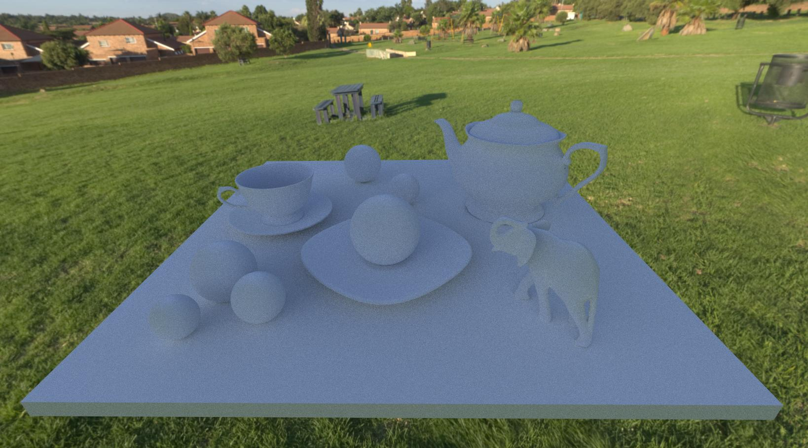
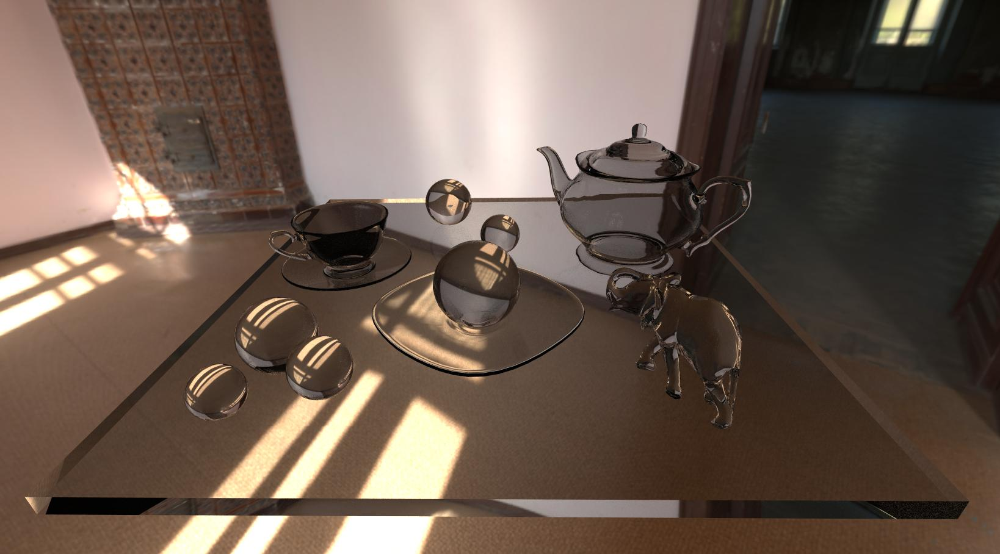
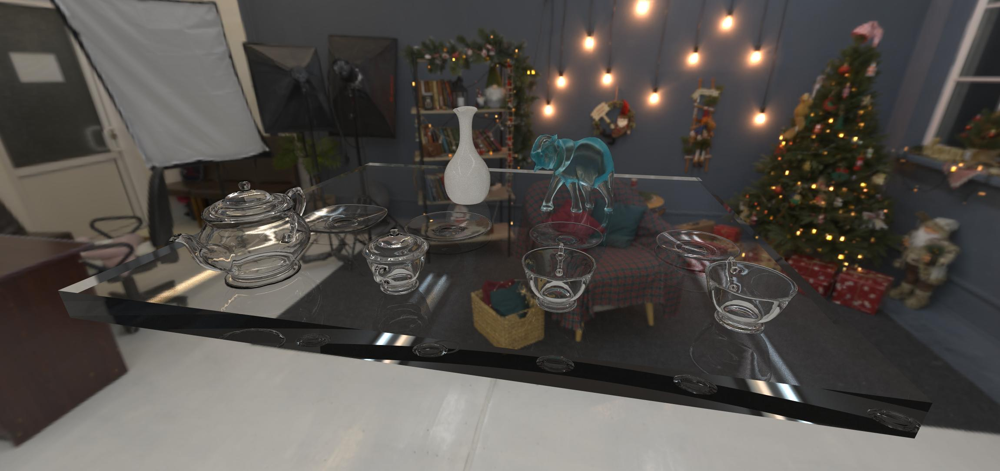

# Pathtracer-RayStorm

Unity Compute Shader 路径追踪实验工程。完整 Unity 工程位于 `Project/`。

## 使用

1. 使用 Unity 2022.3 打开 `Project/`（原工程记录版本为 2022.3.27f1）。
2. 打开 `Assets/Scenes/SampleScene.unity`，或 `Assets/RayStorm/Example/` 中的示例。
3. 进入 Play 模式，渲染器按图块逐步生成图像。示例默认输出一帧，完成后保存到 `Assets/RaytraceOutput0.jpg`。
4. Inspector 可选择行为、环境 Cubemap 和帧数。帧数为 0 时持续输出；运行时可显示八叉树或手动保存。

需要支持 Compute Shader 与可随机写入 ARGBFloat 的 GPU。工程使用内置渲染管线。三个 Compute Shader 已在示例场景中显式引用，Player 输出目录为 `Application.persistentDataPath`。

## 正确性与工程修复

- 八叉树使用保守包围盒和完整覆盖检查；GPU 使用有界栈遍历并按最近距离剪枝。
- 浮点累积按实际样本数加权；尾块和线程组访问均检查边界。
- 漫反射采用余弦加权采样；粗糙反射处理 BSDF/PDF 权重、有效半球和几何法线偏移。
- 支持正交相机；输出帧固定相机参数，视角或尺寸变化时重启当前帧。
- 网格输入校验、逆转置法线、单份子网格顶点数据，以及临时资源清理。
- 复用光线缓冲，按任务数、射线数量和 CPU 提交时间限制每次 Update 的工作量；这些限制不等同于 GPU 耗时预算。
- 共享 Compute Shader 在每次 Dispatch 前重新绑定实例资源；Inspector 支持序列化与 Undo。
- 累积保留线性 HDR，显示与 LDR 导出使用曝光 1 的 Reinhard 映射及 sRGB 输出。

这是简化材质模型的渲染实验工程，当前材质主要使用常量参数；Unity Light、材质纹理、MIS 和降噪尚未接入。`Shader/Library` 中的旧动态模板不属于当前渲染路径。

## 回归验证

在空场景中执行菜单 **RayStorm → Validate All**，或使用：

```powershell
& '<Unity Editor>/Unity.exe' -batchmode -force-d3d11 -projectPath '<repository>/Project' -executeMethod RayStorm.RayStormValidation.RunAll -logFile '<validation.log>'
```

验证覆盖八叉树几何完整性、最近命中、场景采集、任务覆盖、GPU 累积与显示、材质基础响应、相机、多实例和资源清理。结果写入 `Project/ValidationResults/validation.json`。GPU 验证需要图形设备，不能使用 `-nographics`。

本次实际执行环境与结果见 [验证记录](Document/Validation.md)。

## 介绍

基于Unity-ComputeShader的RayStorm路径追踪器。

## 效果

<p align="center">
	
	<center style="color:#C0C0C0"> Diffuse  </center>
</p>

<p align="center">
	
	<center style="color:#C0C0C0"> Mirror  </center>
</p>

<p align="center">
	
	<center style="color:#C0C0C0"> Mirror  </center>
</p>

<p align="center">
	
	<center style="color:#C0C0C0"> Example  </center>
</p>

## 特性

* Unity场景构建
  * 将Unity中搭建好的场景导入到RayStorm中进行渲染
* 材质
  * 漫反射（石膏）
  * 金属材质
  * 非透明电介质（塑料、陶瓷）
  * 透明电介质（玻璃）
* 优化
  * 场景八叉树
