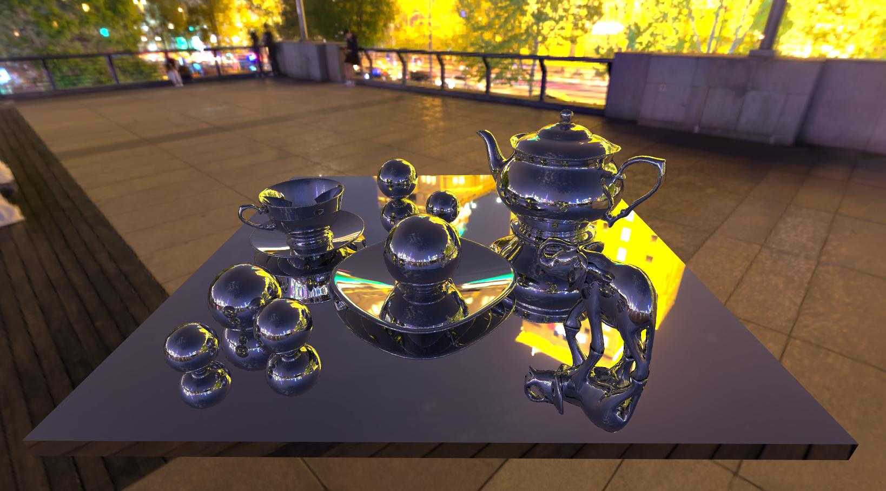

# Pathtracer-RayStorm

## 介绍

基于Unity-ComputeShader的RayStorm路径追踪器。

## 效果

	
	
 Diffuse  

	
	
 Mirror  

	
	
 Mirror  

	
	
 Example  

## 特性

* Unity场景构建
  * 将Unity中搭建好的场景导入到RayStorm中进行渲染
* 材质
  * 漫反射（石膏）
  * 金属材质
  * 非透明电介质（塑料、陶瓷）
  * 透明电介质（玻璃）
* 优化
  * 场景八叉树